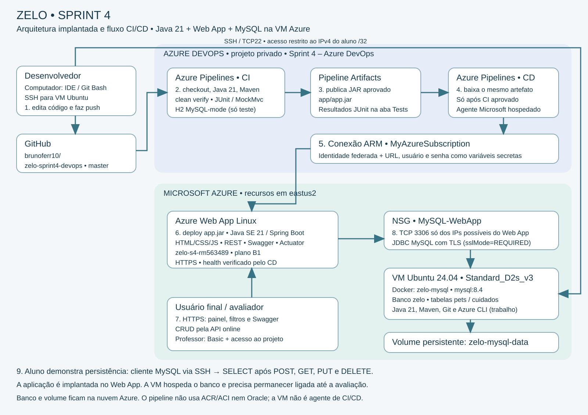

# Zelo — Sprint 4 — DevOps Tools & Cloud Computing

Professor João Menk · Turma 2TDSR · Branch `master`

Java 21 no Azure Web App Linux, MySQL 8.4 em container Docker numa VM Azure e CI/CD no Azure DevOps.

## 1. Integrantes

| Nome completo | RM | Turma |
|---|---|---|
| Hebert Lopes do Santos | 563192 | 2TDSR |
| Nicolas Monteiro Ramiro | 562380 | 2TDSR |
| Marcus Vinícius Vila Nova da Silva | 558771 | 2TDSR |
| Bruno Ferreira | 563489 | 2TDSR |
| Gabriel Robertoni Padilha | 566293 | 2TDSR |


## 2. Solução e evolução

Zelo organiza pets e cuidados preventivos, como vacinas, consultas e exames. A API oferece CRUD, validações, relacionamento 1:N, Swagger e painel web. A Sprint 4 preserva o CRUD da Sprint 3 e acrescenta filtros combinados, resumo preventivo e automação de build, testes e deploy.

### Evolução funcional da Sprint 3 para a Sprint 4

| Sprint 3 | Sprint 4 |
|---|---|
| CRUD de Pets/Cuidados e filtro por pet | CRUD preservado; filtros combináveis por pet, status e período inclusivo |
| Página de confirmação | Painel com filtros, tabela e totais atualizados pela API |
| Sem resumo preventivo | Pendentes, atrasados, concluídos e cancelados em /api/cuidados/resumo |
| Sem CI/CD Azure DevOps | Build, testes, publicação do JAR e deploy Web App automáticos |

GET /api/cuidados e GET /api/cuidados/resumo aceitam `petId`, `status`, `dataInicio` e `dataFim` opcionais. Datas ISO `yyyy-MM-dd`, período inclusivo; pode informar somente um limite. Status: PENDENTE, ATRASADO, CONCLUIDO, CANCELADO. Lista ordenada por data prevista e ID. Período invertido, data inválida ou status inválido retornam 400. Sem resultados: lista vazia e resumo com zeros.

Exemplo: `/api/cuidados?status=PENDENTE&dataInicio=2026-11-01&dataFim=2026-12-31`. O resumo aplica os mesmos filtros. Nele, PENDENTE com data anterior ao dia atual em UTC conta como atrasado, e ATRASADO explícito também; CONCLUIDO/CANCELADO não contam como atraso. Categorias não se sobrepõem e somam o total. O filtro por status usa o valor salvo no banco. O cálculo não altera status nem grava no banco.

A página `/` consome essas rotas, exibe carregamento/erro/estado vazio e oferece acesso ao Swagger para o CRUD. Não há mudança de schema para esses novos recursos: consultas usam colunas existentes.

## 3. Acessos e evidências verificadas

| Item | Endereço / situação |
|---|---|
| GitHub | https://github.com/brunoferr10/zelo-sprint4-devops |
| Projeto Azure DevOps | https://dev.azure.com/RM562380/Sprint%204%20%E2%80%93%20Azure%20DevOps |
| Aplicação online | https://zelo-s4-rm563489.azurewebsites.net |
| Swagger | https://zelo-s4-rm563489.azurewebsites.net/swagger-ui/index.html |
| Saúde | https://zelo-s4-rm563489.azurewebsites.net/actuator/health |
| Vídeo YouTube | A inserir depois da gravação; obrigatório antes da entrega |

Validação realizada pelo grupo em 04/11/2026: execução #20261104.1 com CI e CD aprovados, 100% dos testes aprovados e um artefato publicado. Execução #20261104.2 disparada por push na master (Individual CI); título atualizado visível no Web App. A API de resumo retornou zeros corretamente sem cuidados. O CRUD de pets foi exercitado via Web App/Swagger, com SELECT confirmando criação, atualização e exclusão no MySQL. Esses resultados registram a validação realizada, não monitoramento contínuo.

O professor já tem nível Basic na organização; sua inclusão em Project Administrators deste projeto foi realizada pelo grupo. Confira a lista de membros e preserve o acesso até a avaliação. O vídeo ainda precisa demonstrar todos os itens obrigatórios.

## 4. Stack e arquitetura implantada

Java 21; Spring Boot 3.4.5; Spring Web; JPA/Hibernate; Bean Validation; MySQL Connector/J; MySQL 8.4; Swagger/OpenAPI; Actuator; HTML/CSS/JavaScript; Maven; JUnit/MockMvc; H2 exclusivamente nos testes em modo MySQL; Git/GitHub; Azure Pipelines; Pipeline Artifacts; Azure CLI; Docker; Ubuntu 24.04; App Service Linux Java SE 21.



| Ordem | Ferramenta e papel |
|---|---|
| 1 | Desenvolvedor edita código na VM via SSH/IDE e faz push na master do GitHub |
| 2 | Azure Pipelines CI em agente Microsoft ubuntu-latest: checkout, Java 21, Maven build e testes |
| 3 | CI publica o JAR testado como artefato app/app.jar e resultados JUnit |
| 4 | CD depende do CI aprovado e baixa o artefato da mesma execução |
| 5 | Service connection MyAzureSubscription via identidade federada configura datasource protegido |
| 6 | AzureWebApp@1 publica app.jar no Azure Web App Linux; Actuator verifica saúde |
| 7 | Usuário final / avaliador acessa painel e Swagger por HTTPS |
| 8 | Web App usa JDBC/MySQL com TLS pela porta 3306; NSG limita origem aos IPs do Web App |
| 9 | Aluno / avaliador observa SELECTs no MySQL via SSH na VM; dados em volume persistente |

A VM tem dois papéis: estação de trabalho e hospedagem do banco. O deploy da aplicação é no Web App, atendendo ao destino exigido. A VM não é agente de pipeline: o agente é Microsoft-hosted. O banco está em nuvem porque o container está executando na VM Azure. ACR, ACI e Oracle não participam desta arquitetura.

## 5. Recursos reais e rede

| Recurso | Configuração |
|---|---|
| Assinatura | Azure for Students |
| Região dos recursos | eastus2 (East US 2), permitida pela política da assinatura |
| Grupo da VM | rg-zelo-s4-vm; metadado de localização do grupo: canadacentral; VM/rede em eastus2 |
| VM | vm-zelo-sprint4; Standard_D2s_v3; Ubuntu 24.04 x64; usuário bruno |
| IP público da VM | 172.200.20.110; conferir no Portal caso o recurso seja recriado |
| NSG | zelo-s4-vm-nsg |
| SSH | SSH-do-aluno; TCP 22; apenas IPv4 público atual do aluno /32 |
| Banco | zelo-mysql; imagem mysql:8.4; porta 3306; banco zelo; usuário zelo_user |
| Persistência | volume Docker zelo-mysql-data em /var/lib/mysql; volume não substitui backup |
| Acesso do Web App ao banco | regra MySQL-WebApp, prioridade 1100, TCP 3306, IPs possibleOutboundIpAddresses |
| Grupo do Web App | rg-zelo-s4-webapp |
| Plano | plan-zelo-s4; Linux B1 |
| Web App | zelo-s4-rm563489; Java SE 21; HTTPS obrigatório |
| Startup | java -jar /home/site/wwwroot/app.jar |

Não abrir 3306 para toda a internet nem 8080 publicamente para a aplicação na VM. Se o IP do aluno mudar, atualize somente a regra SSH; se as saídas do Web App mudarem, atualize MySQL-WebApp com scripts/08-liberar-mysql-webapp.sh. O JDBC usa sslMode=REQUIRED: tráfego criptografado, sem validação da identidade do certificado do MySQL. Não equivale a VERIFY_IDENTITY.

## 6. Arquivos e preparação

| Arquivo | Função |
|---|---|
| azure-pipelines.yml | Pipeline CI/CD já validada |
| scripts/00-config.sh | Nomes e defaults eastus2 / Standard_D2s_v3 |
| scripts/01-criar-vm-linux.sh | Cria VM/rede; reutiliza grupo existente; sem desligamento automático |
| scripts/02-preparar-ubuntu.sh | Git, JDK21, Maven e Azure CLI |
| scripts/03-criar-webapp.sh | Provisiona plano e Web App Java 21 |
| scripts/04-configurar-datasource.py | Configura appsettings sem imprimir segredos |
| scripts/05-testar-webapp.sh | Verifica endpoint de saúde online |
| scripts/06-encerrar.sh | Desaloca somente após avaliação e opção explícita |
| scripts/07-preparar-mysql.sh | Nova instalação Docker/MySQL; recusa sobrescrever banco existente |
| scripts/08-liberar-mysql-webapp.sh | Libera3306 só para IPs possíveis do Web App |
| script_bd.sql | DDL MySQL equivalente ao schema validado; sem DROP/dados automáticos |
| docs/consultas-evidencia.sql | SELECTs e resumo MySQL |
| docs/CONFIGURAR-AZURE.md | Sequência de provisionamento |
| docs/roteiro-video.md | Passo a passo da gravação |
| docs/ENTREGA.md | Modelo dos dados do PDF final |
| postman/ | Coleção de chamadas REST |

O pacote remove arquivos antigos de ACR/ACI para não misturar rotas. A aplicação Java, configuração de execução, testes e YAML desta versão foram preservados. Atualizar os arquivos não exige recriar os recursos atuais nem importar o SQL novamente.

## 7. Retomar o ambiente existente

No Git Bash do computador local:

```bash
ssh -i ~/.ssh/zelo_sprint4 bruno@172.200.20.110
```

Na VM:

```bash
cd ~/zelo-sprint4-devops
sudo systemctl is-active docker
sudo docker ps --filter name=zelo-mysql
java -version
mvn -version
```

Para consultas SQL, na VM:

```bash
sudo docker exec -it zelo-mysql mysql -u zelo_user -p zelo
```

Digite a senha de zelo_user; não é a senha root nem a senha da chave SSH. Não envie senhas ao Git ou no vídeo. `mysql>` recebe SQL; `bruno@vm-zelo-sprint4` recebe comandos Bash. Cloud Shell (`nicolas`) é outro ambiente; seus arquivos efêmeros não são os arquivos da VM.

## 8. Reproduzir infraestrutura em nova instalação

Siga [CONFIGURAR-AZURE.md](docs/CONFIGURAR-AZURE.md). Na assinatura usada pelo grupo, eastus2 é permitida. Tamanho e plano dependem de quota/capacidade atuais: a implantação validada usou Standard_D2s_v3 e B1. Grupo existente não pode ter sua localização alterada por az group create. Não existe garantia de gratuidade. A VM atual não tem desligamento automático configurado.

MySQL usa senhas informadas de forma oculta no script de nova instalação; arquivo temporário privado é removido ao terminar. Credenciais do container são acessíveis a administradores Docker: não mostre docker inspect no vídeo. O volume existente nunca deve ser removido para atualizar código. Execute script_bd.sql apenas em banco novo e vazio; na VM atual o schema já foi criado e validado por Hibernate.

## 9. Azure DevOps e segredos

| Campo | Valor |
|---|---|
| Organização | RM562380 |
| Project Name | Sprint 4 – Azure DevOps |
| Description | Projeto para entrega da Sprint 4 do professor João Menk, com integrantes/RMs/turmas da seção 1 |
| Visibility | Private |
| Version control | Git |
| Work item process | Scrum |
| Professor | Joao Carlos Menk; profjoao.menk@fiap.com.br; Basic; membro do projeto |
| Conexão Azure Resource Manager | MyAzureSubscription; workload identity federation; escopo rg-zelo-s4-webapp |

Pipelines → GitHub → brunoferr10/zelo-sprint4-devops → YAML existente → master → /azure-pipelines.yml. Autorize apenas essa pipeline a usar a conexão. A primeira autorização de recurso é inicial; o YAML não exige aprovação manual de cada deploy.

Em Variables mantenha todos os três valores secretos:

| Nome | Valor / orientação |
|---|---|
| SPRING_DATASOURCE_URL | jdbc:mysql://172.200.20.110:3306/zelo?sslMode=REQUIRED&serverTimezone=UTC |
| SPRING_DATASOURCE_USERNAME | zelo_user |
| SPRING_DATASOURCE_PASSWORD | Senha real de zelo_user, cadastrada somente no campo secreto |

A URL acima descreve host e parâmetros sem senha; a senha não deve integrar a URL. Não commitar arquivo .env real, tokens ou chaves privadas. O Python do CD usa arquivo JSON temporário privado e remove-o no fim. Os logs devem mascarar segredos; não revelar valores no Portal/DevOps durante gravação.

## 10. Etapas da pipeline

| CI | Comportamento |
|---|---|
| trigger master / pr none | Cada push na master inicia CI; pull requests não disparam por este YAML |
| Checkout | Obtém o código do GitHub |
| JavaToolInstaller@0 | Seleciona Java 21 disponível no agente |
| Maven@4 clean verify | Compila e executa testes; falha interrompe entrega |
| JUnit | Publica resultados na aba Tests |
| Preparar JAR | Copia zelo-api-1.0.0.jar para app/app.jar |
| PublishPipelineArtifact@1 | Publica artefato aprovado no Azure DevOps |

| CD | Comportamento |
|---|---|
| dependsOn CI + succeeded + master | Inicia automaticamente após CI aprovado na master |
| DownloadPipelineArtifact@2 | Consome artefato da execução atual |
| AzureCLI@2 | Configura datasource protegido no Web App |
| AzureWebApp@1 | Publica app.jar no Web App Linux Java 21 |
| Verificação online | Consulta Actuator e falha se aplicação não ficar saudável no prazo |

O deploy inicial manual foi seguido de push real no código que disparou a execução #20261104.2 automaticamente. O título online passou a Zelo — Sprint 4 | Deploy automático. Para gravar o vídeo, faça uma nova alteração visível no código e novo push, sem clicar em Run.

## 11. Testes

```bash
mvn -B clean verify -DfailIfNoTests=true
```

Oito testes: três em CrudIntegrationTest e cinco em CuidadoConsultaIntegrationTest, validados na VM Java 21; a primeira pipeline exibiu 100% aprovados. Cobrem CRUD/relacionamento, validação,404, filtros, ordenação, resumo, período invertido e parâmetros inválidos. H2 modo MySQL é exclusivo dos testes; não substitui o MySQL real. Persistência real foi demonstrada por SELECT após chamadas HTTP no Web App.

## 12. CRUD online e SELECT obrigatório

Base: https://zelo-s4-rm563489.azurewebsites.net, sem :8080. Use Swagger ou Postman. POST válido retorna 201; GET/PUT 200; DELETE 204; validação 400; inexistente 404.

Pet de demonstração (registre o ID retornado):

```json
{"nome":"Luna","especie":"Gato","raca":"Siames","dataNascimento":"2024-03-15","nomeTutor":"Bruno Ferreira"}
```

Cuidado de demonstração (petId deve ser um pet existente, não presumir ID):

```json
{"petId":1,"tipo":"CONSULTA","descricao":"Retorno preventivo","dataPrevista":"2026-12-01","status":"PENDENTE"}
```

No MySQL, substitua os IDs pelos reais:

```sql
SELECT DATABASE();
SELECT id,nome,especie,nome_tutor FROM pets WHERE id=2;
SELECT id,pet_id,tipo,descricao,data_prevista,status FROM cuidados WHERE id=1;
```

Grave POST+SELECT, GET+SELECT, PUT+SELECT atualizado e DELETE+SELECT vazio. Se testar ambas as entidades, exclua primeiro o cuidado e depois o pet por causa da chave estrangeira. Não confundir ausência de linhas com falha: MySQL em modo -e pode não imprimir tabela para resultado vazio. docs/consultas-evidencia.sql inclui consulta do relacionamento e resumo UTC.

No ensaio, Luna ID2 foi criada, renomeada para Luna Atualizada e excluída; Mel ID1 permaneceu. Use novo cadastro/ID no vídeo. O painel sem cuidados mostra zeros: isso não é erro. O resumo vazio foi validado; demonstração com cuidados preenchidos é útil para evidenciar filtros e evolução funcional.

## 13. Vídeo e entrega final

Siga [roteiro-video.md](docs/roteiro-video.md). Grave 720p ou superior, áudio claro, explicação por voz, sem legendas. Mostre ferramentas, diagrama, cada etapa durante execução, alteração de código, push automático, testes, artefato, recursos no Portal, app atualizado e CRUD online com SELECT no banco.

Não usar apenas execução pronta como substituto da explicação durante o fluxo. Não alterar apenas README para provar mudança. Não mostrar app somente em localhost. Suba o vídeo no YouTube com acesso ao professor e preencha o link aqui e em docs/ENTREGA.md.

PDF obrigatório contém somente: nomes completos, RMs, turma e três links GitHub/YouTube/Azure DevOps. Não incluir conteúdo técnico, roteiro ou prints no PDF. Não gerar versão final com link de vídeo pendente.

## 14. Checklist da finalização

- [x] Java 21 / MySQL real / Web App provisionados e aplicação acessada online.
- [x] CI com testes e publicação de artefato aprovado.
- [x] Push de código na master disparou execução automática e atualizou título online.
- [x] CRUD de pets ensaiado com confirmação SQL de cadastro, atualização e exclusão.
- [x] Variáveis datasource cadastradas como secretas.
- [x] Professor Basic na organização; inclusão no projeto realizada pelo grupo.
- [ ] Publicar esta documentação e diagrama atualizados no GitHub.
- [ ] Gravar vídeo com fluxo completo, etapas narradas, recursos no Portal e SELECT após cada operação.
- [ ] Verificar acesso do professor ao projeto e vídeo, preencher link YouTube.
- [ ] Gerar PDF final somente com dados e links exigidos.

## 15. Operação e custos

Mantenha VM/MySQL e Web App disponíveis até a avaliação: desligar computador local não desliga recursos Azure. Desalocar a VM interrompe o banco e torna o Web App dependente dele indisponível. O volume preserva dados em reinício, mas não recupera dados de volume/disco excluído. Faça backup antes de mudanças no banco.

Depois da avaliação, scripts/06-encerrar.sh exige ENCERRAR_APOS_AVALIACAO=SIM para desalocar VM; plano B1, disco e IP podem continuar gerando cobrança. Não há exclusão automática de grupos, discos ou volumes.

Em falha, confira Docker ativo, VM ligada, regra 3306, IPs possíveis do Web App, URL/usuário/senha, autorização da conexão e logs. Se o SSH expirar, confira o IPv4 atual do computador e a regra SSH-do-aluno. Não recrie VM nem banco apenas por desconexão SSH.

## 16. Referências

- Materiais de aula do professor João Menk e enunciado Sprint 4: pipeline Java, Azure CLI e Web App; ambiente de trabalho Ubuntu escolhido pelo grupo.
- https://learn.microsoft.com/azure/devops/pipelines/tasks/reference/azure-web-app-v1
- https://learn.microsoft.com/azure/app-service/configure-language-java-deploy-run
- https://learn.microsoft.com/azure/app-service/app-service-ip-addresses
- https://hub.docker.com/_/mysql
