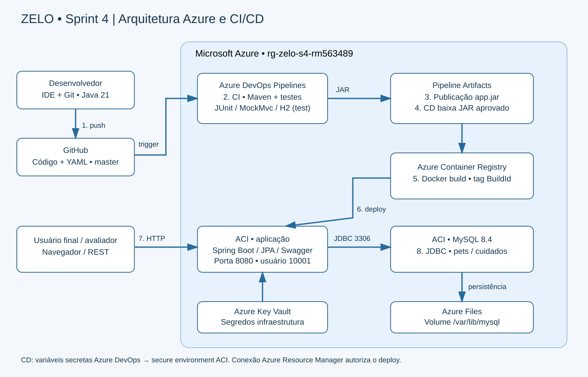

# Zelo — Sprint 4 — DevOps Tools & Cloud Computing

Professor João Menk · Branch master · VM de trabalho Ubuntu · Deploy Azure Web App Linux · Banco Oracle FIAP

## 1. Integrantes

| Nome completo | RM | Turma |
|---|---|---|
| Hebert Lopes do Santos | 563192 | 2TDSR |
| Nicolas Monteiro Ramiro | 562380 | 2TDSR |
| Marcus Vinícius Vila Nova da Silva | 558771 | 2TDSR |
| Bruno Ferreira | 563489 | 2TDSR |
| Gabriel Robertoni Padilha | 566293 | 2TDSR |


## 2. Solução e escopo

Zelo mantém pets e seus cuidados preventivos, como consultas, vacinas e exames. A API Spring Boot oferece CRUD, validação, relacionamento 1:N e Swagger. O foco deste pacote é DevOps: CI/CD, artefatos, testes, deploy e evidência de persistência.

Esta aplicação Java é a base própria desta entrega DevOps e não depende da entrega de outra disciplina ou de outro integrante. Mantém o CRUD da Sprint 3 e acrescenta consulta combinada de cuidados por pet, status e período, resumo preventivo e painel web. A persistência foi adaptada para Oracle FIAP.

### Evolução funcional da Sprint 3 para a Sprint 4

| Sprint 3 | Sprint 4 |
|---|---|
| CRUD de Pets/Cuidados e filtro por pet | CRUD preservado; filtros combináveis por pet, status e período inclusivo |
| Página de confirmação | Painel com filtros, tabela e totais atualizados pela API |
| Sem resumo preventivo | Pendentes, atrasados, concluídos e cancelados em /api/cuidados/resumo |
| Sem CI/CD Azure DevOps | Build, testes, publicação do JAR e deploy Web App automáticos |

GET /api/cuidados e GET /api/cuidados/resumo aceitam `petId`, `status`, `dataInicio` e `dataFim` opcionais. Datas ISO `yyyy-MM-dd`, período inclusivo; pode informar somente um limite. Status: PENDENTE, ATRASADO, CONCLUIDO, CANCELADO. Lista ordenada por data prevista e ID. Período invertido, data inválida ou status inválido retornam 400. Sem resultados: lista vazia e resumo com zeros.

Exemplo: `/api/cuidados?status=PENDENTE&dataInicio=2026-11-01&dataFim=2026-12-31`. O resumo aplica os mesmos filtros. Nele, PENDENTE com data anterior ao dia atual em UTC conta como atrasado, e ATRASADO explícito também; CONCLUIDO/CANCELADO não contam como atraso. Categorias não se sobrepõem e somam o total. O filtro por status usa o valor salvo no banco. O cálculo não altera status nem grava no banco.

A página `/` consome essas rotas, exibe carregamento/erro/estado vazio e oferece acesso ao Swagger para o CRUD. Não há mudança de schema para esses novos recursos: consultas usam colunas existentes.

## 3. Links e situação

| Item | Valor |
|---|---|
| GitHub | https://github.com/brunoferr10/zelo-sprint4-devops |
| Azure DevOps | PENDENTE: inserir link real |
| YouTube | PENDENTE: inserir link real |
| Aplicação | PENDENTE: inserir URL HTTPS retornada pela Azure |
| Deploy e testes online | PENDENTES de execução na assinatura do grupo |

Este pacote substitui o caminho ACR/ACI/MySQL. Não execute scripts antigos desses recursos. Os scripts novos criam VM Ubuntu e Web App Linux; Oracle FIAP já é um serviço externo, não é criado na VM.

## 4. Stack e arquitetura

Java 21, Spring Boot 3.4.5, Spring Web, JPA/Hibernate, Bean Validation, Oracle JDBC, Oracle FIAP, Swagger e Actuator. Maven, JUnit, MockMvc e H2 em escopo test. GitHub, Azure DevOps, Pipeline Artifacts, Azure CLI, VM Ubuntu Server 24.04 e Azure App Service Linux Java SE 21.



| Ordem | Fluxo |
|---|---|
| 1 | Desenvolvedor na VM Ubuntu edita código e faz push na master do GitHub |
| 2 | Azure Pipelines executa build Maven e testes em agente ubuntu-latest |
| 3 | CI publica JAR aprovado como artefato app/app.jar |
| 4 | CD baixa o artefato da mesma execução após CI aprovado |
| 5 | Conexão Azure Resource Manager configura datasource com variáveis secretas |
| 6 | AzureWebApp@1 implanta o JAR no Web App Linux |
| 7 | Usuário/avaliador acessa página e Swagger por HTTPS |
| 8 | Aplicação faz CRUD via JDBC no Oracle FIAP; aluno comprova com SELECT |

A VM é estação de trabalho; não é o destino de deploy nem agente próprio automaticamente. Navegador e gravação podem ficar no computador local, com SSH/VS Code Remote SSH na VM. Ubuntu Server não inclui área de trabalho gráfica.

## 5. Estrutura

| Arquivo/pasta | Função |
|---|---|
| azure-pipelines.yml | CI com testes/artefato e CD Web App |
| scripts/00-config.sh | Região e nomes dos recursos |
| scripts/01-criar-vm-linux.sh | VM Ubuntu por Azure CLI no Cloud Shell |
| scripts/02-preparar-ubuntu.sh | Git, JDK 21, Maven e Azure CLI na VM |
| scripts/03-criar-webapp.sh | App Service Plan e Web App Java Linux |
| scripts/04-configurar-datasource.py | Configura segredos no Web App sem imprimi-los |
| scripts/05-testar-webapp.sh | Verifica saúde do deploy |
| scripts/06-encerrar.sh | Desaloca a VM e documenta limpeza posterior |
| script_bd.sql | DDL Oracle, sequências e dados iniciais |
| docs/consultas-evidencia.sql | SELECTs para cada operação CRUD |
| src/main / src/test | Aplicação e testes automáticos |
| postman/ | Coleção REST |
| docs/ENTREGA.md | Dados para gerar PDF final após preencher links |

## 6. Preparar o repositório

Substitua os arquivos antigos pelo conteúdo deste pacote, preservando .git. Remova também docker/, docker-compose.yml e os scripts antigos: copiar por cima sem remover deixa arquivos obsoletos.

```bash
git add -A
git commit -m "feat: migrar DevOps para Web App Linux e Oracle"
git push origin master
```

Não precisa force se estiver trabalhando no clone atualizado. Nenhum segredo deve ser salvo no Git. Não use senha real no .env.example.

## 7. Criar a VM Ubuntu

A escolha Linux adapta a estação Windows do script da aula; o fluxo Java Web App/Oracle segue o exemplo fornecido. VM não é exigida como destino de entrega.

No seu Git Bash local, gere uma chave dedicada se ainda não tiver:

```bash
ssh-keygen -t ed25519 -f ~/.ssh/zelo_sprint4
cat ~/.ssh/zelo_sprint4.pub
```

Não sobrescreva uma chave existente. Guarde a chave privada e sua senha. Somente o conteúdo .pub é enviado ao Cloud Shell.

No Portal Azure abra Cloud Shell Bash. Clone o projeto atualizado:

```bash
git clone --branch master https://github.com/brunoferr10/zelo-sprint4-devops.git
cd zelo-sprint4-devops
az account show -o table
# Se necessario: az account set --subscription ID_DA_ASSINATURA
```

Crie no Cloud Shell um arquivo de chave pública (cole a linha .pub do seu computador, nunca a chave privada):

```bash
nano ~/zelo_sprint4.pub
export SSH_PUBLIC_KEY_FILE=~/zelo_sprint4.pub
# Substitua pelo IP PUBLICO do seu computador, nao pelo IP do Cloud Shell:
export SSH_SOURCE_CIDR='SEU_IP_PUBLICO/32'
# Ajuste se a assinatura exigir outra regiao:
export LOCATION=canadacentral
bash scripts/01-criar-vm-linux.sh
```

O script cria rg-zelo-s4-vm, vm-zelo-sprint4, Ubuntu 24.04 x64, Standard_B2s, disco Standard SSD 32GB, SSH restrito ao IP informado e desligamento 02:30 UTC (23:30 Brasília). Tamanho/região sujeitos a quota, disponibilidade e custo; revise antes. Não é promessa de gratuidade.

Com o IP retornado, conecte do Git Bash local:

```bash
ssh -i ~/.ssh/zelo_sprint4 bruno@IP_PUBLICO_DA_VM
```

## 8. Preparar ferramentas dentro da VM

```bash
git clone --branch master https://github.com/brunoferr10/zelo-sprint4-devops.git
cd zelo-sprint4-devops
bash scripts/02-preparar-ubuntu.sh
java -version
mvn -version
az login --use-device-code
az account show -o table
```

Configure Git com seu nome e e-mail antes de commits feitos na VM. Use VS Code Remote SSH ou editor de terminal. Configure autenticação GitHub por credencial/SSH sem colocar token no código ou no vídeo.

## 9. Preparar Oracle FIAP

Use suas credenciais Oracle FIAP, sem compartilhá-las no Git. Conexão de exemplo da aula: host oracle.fiap.com.br, porta 1521, service name ORCL. Confirme acesso e parâmetros vigentes na FIAP.

Conecte com SQL Developer ou SQLcl ao schema do aluno e execute script_bd.sql uma vez, antes do primeiro deploy. O arquivo cria pets, cuidados, duas sequências e dados iniciais; não apaga objetos existentes. Se já houver tabelas com esses nomes, confira e faça backup/planeje migração antes de rodar; não execute DROP automaticamente. Esta preparação não altera a senha nem cria usuário no Oracle FIAP.

A aplicação usa ddl-auto=validate: schema precisa estar correto. IDs usam sequências Oracle com allocationSize=1. Verifique conectividade tanto do cliente de consultas quanto do Web App; rede da FIAP pode restringir acesso. Sem conectividade Web App → Oracle não é possível concluir o deploy funcional.

## 10. Criar Web App Linux

Na VM autenticada na Azure, execute:

```bash
export LOCATION=canadacentral
# Nome global: altere se estiver ocupado e mantenha o mesmo no YAML.
export WEB_APP_NAME=zelo-s4-rm563489
bash scripts/03-criar-webapp.sh
```

Cria rg-zelo-s4-webapp, plan-zelo-s4 (Linux B1), Web App Java SE 21, HTTPS obrigatório e startup java -jar /home/site/wwwroot/app.jar. B1 é pago; APP_SKU pode ser ajustado se o plano/região suportar. O Oracle FIAP permanece externo. Não é necessário expor portas 8080/3306 da VM.

## 11. Projeto Azure DevOps e professor

| Campo | Valor |
|---|---|
| Project Name | Sprint 4 – Azure DevOps |
| Description | Projeto para entrega da Sprint 4 do professor João Menk; adicionar os cinco nomes, RMs e turma 2TDSR da seção 1 |
| Visibility | Private |
| Version control | Git |
| Work item process | Scrum ou Agile |

Em Organization settings > Users convide o professor com e-mail institucional confirmado e nível Basic, concedendo acesso ao projeto. Em Project settings > Permissions > Project Administrators adicione o professor, conforme print da entrega. Confirme acesso ao projeto e Pipelines. Mantenha até a avaliação.

Crie Service connection Azure Resource Manager, preferencialmente Workload identity federation, para assinatura e grupo rg-zelo-s4-webapp. Nome MyAzureSubscription. Autorize a pipeline. Identidade precisa gerenciar Web App e deploy no grupo (por exemplo Contributor no grupo, sujeito às políticas da assinatura).

## 12. Pipeline e segredos

Pipelines > New pipeline > GitHub > brunoferr10/zelo-sprint4-devops > Existing YAML > master > /azure-pipelines.yml.

Em Variables configure os três valores abaixo e marque todos como secretos:

| Variável | Valor |
|---|---|
| SPRING_DATASOURCE_URL | jdbc:oracle:thin:@//oracle.fiap.com.br:1521/ORCL (confirmar na FIAP) |
| SPRING_DATASOURCE_USERNAME | Usuário Oracle do schema preparado |
| SPRING_DATASOURCE_PASSWORD | Senha Oracle |

No YAML, WEB_APP_NAME deve corresponder ao nome efetivo do Web App, APP_RG ao grupo e azureSubscription à conexão de serviço. São nomes não sensíveis. Não use set -x e não abra valores secretos na gravação.

| CI | Resultado |
|---|---|
| Trigger master | Cada push na master inicia execução |
| JavaToolInstaller@0 | Java 21 |
| Maven@4 clean verify | Build e oito testes de integração MockMvc com H2 Oracle-mode |
| JUnit | Resultados na aba Tests |
| PublishPipelineArtifact@1 | Artefato app contendo app.jar após aprovação dos testes |

| CD automático | Resultado |
|---|---|
| dependsOn CI + succeeded + master | Só inicia com CI aprovado na master |
| DownloadPipelineArtifact@2 | Baixa JAR da execução atual |
| AzureCLI@2 | Configura datasource usando arquivo temporário privado, removido ao terminar |
| AzureWebApp@1 | Implanta JAR no Web App Linux Java 21 |
| Verificação Actuator | Falha se app não responder no prazo |

Use Save and run para primeira validação; depois prove o trigger com push de alteração de código. Não há aprovação manual no YAML. Se organização não tiver capacidade de agente hospedado, solicite paralelismo ou configure agente próprio e ajuste pool. A VM de trabalho não vira agente automaticamente.

## 13. Testes e validação

```bash
mvn -B clean verify -DfailIfNoTests=true
```

Testes originais (3): CRUD completo Pets/Cuidados com relacionamento, atualização e 404 após exclusão; pet inválido retorna 400; pet inexistente retorna 404. Novos testes (5): filtros combinados e limites inclusivos/ordenação; resumo com atraso calculado sem dupla contagem; resumo filtrado e vazio; período invertido em ambas as rotas; status/data inválidos. H2 é apenas teste, não banco de entrega. H2 Oracle-mode não substitui integração real Oracle.

A preparação do pacote não executou recursos Azure nem acessou Oracle FIAP. Sintaxe e consistência foram verificadas. A tentativa de Maven neste ambiente foi bloqueada pela conexão de rede ao repositório de dependências e o runtime disponível era Java 17; não houve execução de testes concluída em Java 21. Os resultados de build/testes devem ser validados na VM ou pipeline antes da gravação. Não declare aprovação sem execução real.

Após CD, acesse URL HTTPS retornada pelo Web App: /, /swagger-ui/index.html, /actuator/health, /api/pets e /api/cuidados. Execute bash scripts/05-testar-webapp.sh autenticado na Azure.

## 14. CRUD e evidência SQL

Use Swagger ou coleção Postman com base URL https://HOST_REAL_DO_WEBAPP (sem :8080). Pets e Cuidados oferecem GET geral e /{id}, POST, PUT /{id} e DELETE /{id}. Cuidados também aceita GET ?petId=ID. POST retorna 201, GET/PUT 200 e DELETE 204 no fluxo válido; 400 para validação e 404 para recurso inexistente.

POST/PUT pet:

```json
{"nome":"Mel","especie":"Cao","raca":"Beagle","dataNascimento":"2023-04-12","nomeTutor":"Bruno Ferreira"}
```

POST/PUT cuidado (substitua petId pelo ID real):

```json
{"petId":3,"tipo":"CONSULTA","descricao":"Retorno preventivo","dataPrevista":"2026-12-01","status":"PENDENTE"}
```

No PUT altere nomeTutor e status/descrição para mostrar a mudança. Use IDs retornados, sem presumir ID 3. Execute consultas no mesmo schema Oracle:

```sql
SELECT USER FROM dual;
SELECT * FROM pets WHERE id = 3;
SELECT * FROM cuidados WHERE id = 3;
```

Para cada entidade: POST + SELECT do registro; GET + SELECT; PUT + SELECT atualizado; DELETE + SELECT sem linhas. Exclua cuidado antes do pet. docs/consultas-evidencia.sql inclui relacionamento e listas. Mostre comandos e resultados legíveis no vídeo.

## 15. Provar mudança de código e roteiro do vídeo

Prepare IDE/SSH, GitHub, Azure DevOps, Portal, Swagger e cliente Oracle. Vídeo 720p ou superior, áudio claro, explicação por voz, sem legendas.

1. Mostre proposta, stack, arquitetura numerada, personas e ferramentas.
2. Mostre projeto privado, descrição e acesso Basic/administrador do professor.
3. Abra pipeline e explique cada task, trigger, testes, artefato e segredos protegidos.
4. Mostre página atual online; altere título visível em src/main/resources/static/index.html.
5. Faça commit/push na master e mostre início automático.
6. Durante a execução explique CI/CD, abra logs, Tests e artefato app.jar.
7. Mostre Web App no Portal e o deploy concluído. Abra a página HTTPS com título novo, recarregando sem cache.
8. Faça CRUD completo com SELECT após cada operação no Oracle.
9. Confira acesso ao vídeo e links finais.

```bash
git add src/main/resources/static/index.html
git commit -m "feat: demonstrar atualizacao automatica do titulo"
git push origin master
```

Alterar somente README não atende à evidência de código. A primeira execução manual não substitui o push que inicia automaticamente CI/CD. Demonstre também a evolução funcional: aplique filtros no painel, confira o resumo e compare com SELECTs no Oracle.

### Evidência da evolução no Oracle

```sql
SELECT id, pet_id, status, data_prevista FROM cuidados
WHERE status = 'PENDENTE'
  AND data_prevista >= DATE '2026-11-01'
  AND data_prevista < DATE '2027-01-01'
ORDER BY data_prevista, id;
-- Resumo sem filtros: compara a classificacao com o dia UTC usado pela API.
SELECT COUNT(*) AS total,
 SUM(CASE WHEN status='PENDENTE' AND data_prevista >= TRUNC(CAST(SYS_EXTRACT_UTC(SYSTIMESTAMP) AS DATE)) THEN 1 ELSE 0 END) AS pendentes,
 SUM(CASE WHEN status='ATRASADO' OR (status='PENDENTE' AND data_prevista < TRUNC(CAST(SYS_EXTRACT_UTC(SYSTIMESTAMP) AS DATE))) THEN 1 ELSE 0 END) AS atrasados,
 SUM(CASE WHEN status='CONCLUIDO' THEN 1 ELSE 0 END) AS concluidos,
 SUM(CASE WHEN status='CANCELADO' THEN 1 ELSE 0 END) AS cancelados
FROM cuidados;
```

Adicione os mesmos predicados de pet/status/período ao SQL ao comparar um resumo filtrado. Os resultados de SUM podem ser NULL sem registros; a API retorna zero. Essa evidência é adicional ao CRUD obrigatório.

## 16. Checklist e PDF

- [ ] Validar filtros, resumo e painel desta base Java própria sem regredir o CRUD ou CI/CD.
- [ ] VM/ferramentas, schema Oracle e Web App configurados.
- [ ] Projeto privado e professor Basic com acesso ao projeto conforme print.
- [ ] Push master dispara CI, testes aparecem e artefato é publicado.
- [ ] CD consome artefato automaticamente e deploy fica saudável.
- [ ] Usuário/senha/tokens protegidos, ausentes do Git e vídeo.
- [ ] Diagrama corresponde aos recursos realmente implantados.
- [ ] Vídeo mostra mudança de código, cada task, Portal e CRUD com SELECT.
- [ ] URLs reais preenchidas e acessíveis ao professor.
- [ ] PDF final apenas nomes/RMs/turmas e links GitHub, YouTube e Azure DevOps.

Preencha docs/ENTREGA.md e gere o PDF quando os links existirem. Não entregar PDF com placeholders. CI/CD sem funcionar, localhost ou falta de acesso do professor podem zerar a avaliação conforme enunciado; documentação não substitui evidências.

## 17. Diagnóstico e custos

Falha de quota/região VM ou Web App: ajuste região/tamanho/plano permitido. Nome Web App indisponível: altere nome no script/YAML. Falha CI: confira Java 21 e Tests. Falha CD: confira autorização da conexão, artefato, nome do app e logs. Falha Oracle: confira credenciais, URL, schema/sequências e acesso de rede. ORA de objeto existente: não execute DROP; revise schema.

```bash
az webapp log config -g rg-zelo-s4-webapp -n zelo-s4-rm563489 --application-logging filesystem --level information
az webapp log tail -g rg-zelo-s4-webapp -n zelo-s4-rm563489
```

VM, disco, IP e App Service Plan podem gerar cobrança. Desaloque VM quando não estiver usando (scripts/06-encerrar.sh); parar/desalocar VM não elimina custo do plano Web App nem do disco/IP. Preserve ambiente de entrega até avaliação. Limpeza dos dois grupos é manual e separada; Oracle FIAP não é removido pelos scripts.

## 18. Referências

Materiais fornecidos do Prof. João Menk: Azure Pipelines Java, YAML PlayMix e preparação de infraestrutura. Estação de trabalho adaptada para Ubuntu por escolha do grupo; não é cópia literal da VM Windows do material.

- https://learn.microsoft.com/azure/devops/pipelines/tasks/reference/azure-web-app-v1
- https://learn.microsoft.com/azure/app-service/configure-language-java-deploy-run
- https://learn.microsoft.com/azure/virtual-machines/linux/quick-create-cli
- https://learn.microsoft.com/cli/azure/vm
